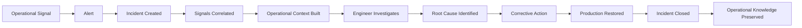
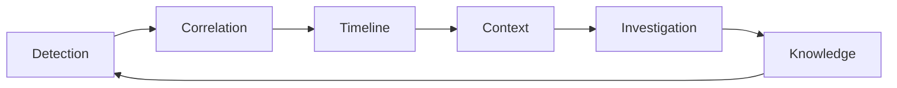

# Product Requirements Document (PRD)

**Version:** 0.1  
**Status:** Approved  
**Document:** `docs/03-product-requirements.md`  
**Project:** Project Sentinel  
**Owner:** Founders  
**Last Updated:** July 30, 2026

---

# Executive Summary

Project Sentinel is an Operational Intelligence Platform designed to help engineering teams investigate and resolve production incidents faster.

Modern engineering teams rely on a fragmented ecosystem of monitoring, logging, exception tracking, deployment history, infrastructure dashboards, and communication tools to understand what is happening in production. While each tool provides valuable information, engineers remain responsible for manually correlating that information during time-sensitive incidents.

Sentinel reduces this cognitive burden by automatically transforming operational signals into meaningful operational context.

Instead of asking engineers to search for the root cause, Sentinel presents a structured understanding of what happened, what changed, what is affected, and what should be investigated next.

The initial version of Sentinel focuses on one measurable outcome:

> **Reduce the time from production alert to root cause.**

Everything included in the MVP must contribute directly to that objective.

---

# Product Vision

Sentinel will become the operational control center for modern software applications.

Rather than replacing every operational tool, Sentinel will unify operational knowledge into a single system that enables engineering teams to understand, investigate, and resolve production incidents efficiently.

Over time, Sentinel will evolve from an incident investigation platform into a comprehensive operational intelligence platform supporting multiple runtimes, deployment models, and engineering workflows.

---

# Mission Statement

> **Help engineering teams understand and resolve production incidents in minutes instead of hours.**

---

# Product Goals

The first version of Sentinel has five primary goals.

## Goal 1 — Reduce Investigation Time

Enable engineers to identify the likely cause of production incidents significantly faster than traditional multi-dashboard workflows.

### Success Criteria

- Reduced Mean Time to Detect (MTTD)
- Reduced Mean Time to Resolve (MTTR)
- Fewer manual investigation steps

---

## Goal 2 — Centralize Operational Context

Present all information required for incident investigation from a single interface.

The engineer should not need to manually navigate multiple operational systems to begin an investigation.

### Success Criteria

- Reduced context switching
- Fewer tools opened during investigations
- Faster onboarding for new engineers

---

## Goal 3 — Increase Deployment Confidence

Provide sufficient operational visibility to help teams deploy software with confidence.

Engineers should immediately understand whether a deployment introduced operational issues.

### Success Criteria

- Faster identification of deployment-related incidents
- Improved confidence during release cycles
- Shorter rollback decisions

---

## Goal 4 — Build an Extensible Operational Platform

Design Sentinel around capabilities rather than technologies so additional runtimes, integrations, and operational modules can be added without redesigning the product.

### Success Criteria

- Modular capabilities
- Consistent user experience
- Clear extensibility model

---

## Goal 5 — Create Daily Operational Value

Sentinel should become part of the daily workflow of engineering teams rather than a tool used only during major outages.

### Success Criteria

- Daily active engineering users
- Frequent incident reviews
- Operational insights used during development and deployment

---

# Non-Goals

The MVP intentionally excludes several areas that, while valuable, do not directly support the primary objective.

Sentinel is **not** intended to become:

- A CI/CD platform
- An infrastructure management system
- A Kubernetes management tool
- A cloud hosting platform
- A centralized logging replacement
- A metrics storage platform
- A feature flag service
- A secrets management platform
- A project management application

These capabilities may become complementary products in the future but are not required to validate the initial product vision.

---

# Product Principles

Every product decision should satisfy the following principles.

## 1. Incident First

The primary object within Sentinel is the **Incident**, not individual logs, metrics, or exceptions.

Operational signals exist to provide context for incidents.

---

## 2. Context Over Data

Present understanding instead of overwhelming users with raw information.

The objective is to reduce cognitive load rather than maximize data visibility.

---

## 3. Actionable by Default

Every screen should help users decide what to do next.

Information without actionable context should be minimized.

---

## 4. Progressive Disclosure

Users should see the most important information first while retaining the ability to drill into technical details when necessary.

The interface should avoid overwhelming engineers during high-pressure incidents.

---

## 5. Integration Rather Than Replacement

Sentinel should complement existing engineering tools whenever practical.

The product should integrate into existing workflows instead of forcing customers to replace their current operational stack.

---

## 6. Opinionated Simplicity

When multiple valid approaches exist, Sentinel should guide users toward best practices rather than exposing unnecessary configuration.

Simplicity should be preferred over flexibility unless flexibility creates significant customer value.

---

## 7. Trust Through Transparency

Recommendations, correlations, and conclusions presented by Sentinel should always be explainable.

Engineers must understand why the platform reached a particular conclusion before acting on it.

---

# Success Metrics

Success will be evaluated using both product and business metrics.

## Product Metrics

| Metric | Description |
|----------|-------------|
| Mean Time to Detect (MTTD) | Average time between failure and detection |
| Mean Time to Resolve (MTTR) | Average time required to restore production |
| Incident Investigation Duration | Time from opening an incident to identifying the likely root cause |
| Daily Active Engineers | Number of engineers actively using Sentinel |
| Weekly Active Organizations | Organizations actively relying on Sentinel |

---

## Customer Success Metrics

| Metric | Description |
|----------|-------------|
| Deployment Confidence | Customer perception of release safety |
| Operational Visibility | Customer confidence in understanding production systems |
| Investigation Efficiency | Reduction in manual investigation effort |
| Customer Satisfaction | Overall satisfaction with incident investigation workflows |

---

## Business Metrics

| Metric | Description |
|----------|-------------|
| Monthly Recurring Revenue (MRR) | Subscription revenue generated each month |
| Customer Retention | Percentage of customers retained over time |
| Expansion Revenue | Revenue generated through existing customers |
| Trial Conversion Rate | Percentage of trial users converting to paid plans |

---

# Product Constraints

The following constraints intentionally shape the first version of Sentinel.

## Scope Constraint

The MVP must remain focused on production incident investigation.

New features that do not directly improve investigation speed should be deferred.

---

## Adoption Constraint

Sentinel should require minimal operational changes for customer adoption.

Organizations should be able to integrate Sentinel incrementally without replacing existing tooling.

---

## Learning Constraint

The product should require minimal training.

Engineers should understand the core workflow immediately after onboarding.

---

## Complexity Constraint

Operational complexity should be hidden behind thoughtful defaults.

Advanced functionality should remain available without becoming the primary user experience.

---

# Assumptions

The current product strategy is based on several assumptions that should be validated through customer interviews and early adoption.

- Engineering teams experience significant operational context switching during incidents.
- Existing observability tools provide data but insufficient operational understanding.
- Teams value faster incident investigation enough to adopt an additional operational platform.
- Customers are willing to integrate Sentinel alongside existing operational tooling before replacing any components.
- The value of operational intelligence increases as historical incident data accumulates.

These assumptions should be revisited regularly as customer feedback becomes available.

---

# Core User Journey

The Sentinel MVP is designed around a single operational workflow.

Rather than exposing isolated operational tools, the platform guides engineers through the complete lifecycle of a production incident.

This user journey serves as the foundation for product design, user experience, system architecture, and future platform capabilities.

Every capability introduced in the MVP should support one or more stages of this workflow.

---

## Primary User Journey

The objective of Sentinel is not to replace engineering judgment.

The objective is to eliminate unnecessary investigation effort by organizing operational information into a coherent, actionable workflow.

---

## Journey Stages

### Stage 1 — Operational Signal

A production environment continuously emits operational signals.

Examples include:

- Exceptions
- Application logs
- Performance metrics
- Queue activity
- Scheduler executions
- Deployment events
- Infrastructure changes
- Health checks

These signals represent observations rather than problems.

A single signal rarely provides sufficient context to determine whether an incident exists.

---

### Stage 2 — Alert

When operational conditions exceed predefined thresholds or external monitoring systems detect abnormal behavior, an alert is generated.

An alert represents the first indication that human attention may be required.

Sentinel may receive alerts from existing monitoring platforms or generate alerts through its own correlation engine in future versions.

An alert does not necessarily represent an incident.

Multiple alerts may describe the same underlying issue.

---

### Stage 3 — Incident Creation

Sentinel evaluates incoming operational information and determines whether a new incident should be created or whether incoming signals belong to an existing incident.

The incident becomes the primary object around which all investigation activities are organized.

Every incident should have:

- A clear timeline
- Current status
- Severity
- Scope
- Related operational signals
- Investigation history

---

### Stage 4 — Signal Correlation

After an incident is created, Sentinel automatically associates relevant operational information.

Correlation may include:

- Related exceptions
- Relevant deployments
- Queue behavior
- Scheduler executions
- Infrastructure events
- Configuration changes
- Service dependencies

The objective is to eliminate manual information gathering.

---

### Stage 5 — Operational Context

Raw operational signals become meaningful only when presented within context.

Sentinel should automatically answer questions such as:

- What changed recently?
- Which applications are affected?
- Which environments are impacted?
- Did a deployment occur before the incident?
- Which services are communicating?
- What changed immediately before failures began?

Operational context should be generated automatically whenever possible.

---

### Stage 6 — Investigation

The engineer begins investigating the incident using the operational context assembled by Sentinel.

The platform should minimize unnecessary navigation by presenting:

- Timeline
- Related events
- Correlated signals
- System relationships
- Historical incidents
- Relevant operational history

The investigation experience should prioritize clarity over data volume.

---

### Stage 7 — Root Cause Identification

The objective of the investigation is to identify the most likely explanation for the observed behavior.

Sentinel should support—not replace—the engineer's reasoning process.

Future versions may provide confidence-ranked hypotheses, but the MVP focuses on presenting sufficient operational context for informed decision-making.

---

### Stage 8 — Corrective Action

Once the likely cause has been identified, engineers perform corrective actions using their existing operational processes.

Examples include:

- Rolling back deployments
- Restarting services
- Fixing configuration
- Scaling infrastructure
- Resolving dependency failures

Future versions of Sentinel may assist or automate selected operational actions.

---

### Stage 9 — Resolution

After corrective actions have been completed, the incident is resolved.

Sentinel records:

- Resolution time
- Investigation timeline
- Related operational signals
- Root cause
- Resolution summary

This information becomes part of the organization's operational history.

---

### Stage 10 — Operational Knowledge

Every resolved incident increases the organization's operational knowledge.

Historical incidents become valuable assets that support:

- Future investigations
- Team onboarding
- Operational analytics
- Continuous improvement
- AI-assisted investigation in future versions

Sentinel should continuously transform operational history into reusable knowledge.

---

# Product Capabilities

Rather than organizing functionality around screens or menus, Sentinel is organized around product capabilities.

Capabilities represent long-term business functions that remain stable even as the user interface evolves.

---

## Capability 1 — Incident Detection

### Purpose

Identify situations requiring engineering attention.

### Responsibilities

- Receive operational signals
- Receive or generate alerts
- Evaluate abnormal behavior
- Create new incidents when appropriate
- Associate new signals with existing incidents

### Business Value

Reduces the delay between operational failure and structured investigation.

---

## Capability 2 — Incident Correlation

### Purpose

Transform isolated operational events into meaningful operational context.

### Responsibilities

- Associate related operational signals
- Correlate deployments
- Correlate infrastructure events
- Correlate application behavior
- Build relationships between operational activities

### Business Value

Eliminates manual correlation across multiple operational systems.

---

## Capability 3 — Operational Timeline

### Purpose

Provide a chronological narrative of an incident.

### Responsibilities

- Present significant operational events
- Highlight important changes
- Preserve investigation history
- Support post-incident analysis

### Business Value

Allows engineers to understand what happened before investigating why it happened.

---

## Capability 4 — Operational Context

### Purpose

Provide engineers with sufficient information to make informed decisions.

### Responsibilities

- Present affected applications
- Present affected environments
- Present related deployments
- Present dependencies
- Present historical context

### Business Value

Reduces cognitive load during high-pressure production incidents.

---

## Capability 5 — Guided Investigation

### Purpose

Support engineers throughout the investigation process.

### Responsibilities

- Highlight relevant information
- Reduce unnecessary navigation
- Organize operational evidence
- Surface relationships between events

Future versions may include intelligent investigation assistance.

### Business Value

Improves investigation efficiency while preserving engineer control.

---

## Capability 6 — Operational Knowledge

### Purpose

Capture organizational learning from every production incident.

### Responsibilities

- Preserve investigation history
- Preserve incident timelines
- Preserve resolutions
- Support future operational analysis

### Business Value

Transforms operational experience into a long-term organizational asset.

---

# Capability Relationships

The capabilities form a continuous operational workflow rather than independent modules.

Each capability strengthens the next, creating a feedback loop in which every resolved incident improves future investigations.

---

# Product Design Principles for Capabilities

Every capability introduced into Sentinel should satisfy the following principles.

## Solve One Clear Operational Problem

Each capability should exist because it removes friction from the incident investigation process.

Capabilities that do not improve operational understanding should be deferred.

---

## Build Upon Previous Capabilities

Capabilities should extend existing workflows rather than creating parallel experiences.

The product should feel cohesive rather than modular from the user's perspective.

---

## Preserve Context

Operational context should never be discarded unnecessarily.

Engineers should always understand why information is presented and how it relates to the current incident.

---

## Enable Future Growth

Capabilities should provide clear extension points for future integrations, automation, and operational intelligence without requiring fundamental redesign.

---

# Functional Requirements

This section defines the functional capabilities required for the initial version of Sentinel.

The requirements describe product behavior independently of implementation details.

---

## Functional Requirement Groups

The MVP is organized into six primary functional areas.

| ID | Capability |
|----|------------|
| FR-100 | Incident Management |
| FR-200 | Operational Context |
| FR-300 | Investigation Experience |
| FR-400 | Collaboration & Knowledge |
| FR-500 | Notifications |
| FR-600 | Administration |

---

# FR-100 — Incident Management

## Objective

Enable engineering teams to detect, manage, investigate, and resolve production incidents from a single operational workspace.

### Requirements

#### FR-101

The system shall create an incident when sufficient operational evidence indicates a production issue.

---

#### FR-102

The system shall associate related operational signals with an existing incident whenever possible.

---

#### FR-103

The system shall maintain the lifecycle of every incident.

Possible lifecycle states include:

- Detected
- Investigating
- Monitoring
- Resolved
- Archived

---

#### FR-104

The system shall maintain a complete investigation timeline for every incident.

---

#### FR-105

The system shall preserve the complete history of incident updates.

---

#### FR-106

The system shall allow incidents to be reopened if additional related operational activity occurs.

---

# FR-200 — Operational Context

## Objective

Provide engineers with sufficient operational context to understand production issues without manually gathering information from multiple systems.

### Requirements

#### FR-201

The system shall correlate operational information relevant to an incident.

---

#### FR-202

The system shall present operational events in chronological order.

---

#### FR-203

The system shall identify operational changes that occurred before an incident.

---

#### FR-204

The system shall present relationships between affected systems, applications, and environments.

---

#### FR-205

The system shall preserve contextual information throughout the investigation lifecycle.

---

# FR-300 — Investigation Experience

## Objective

Provide a structured workflow that enables engineers to identify likely root causes efficiently.

### Requirements

#### FR-301

The system shall provide a dedicated investigation workspace for every incident.

---

#### FR-302

The system shall present related operational evidence without requiring unnecessary navigation.

---

#### FR-303

The system shall allow engineers to record investigation notes.

---

#### FR-304

The system shall allow engineers to record suspected causes during an investigation.

---

#### FR-305

The system shall allow engineers to record the confirmed root cause.

---

#### FR-306

The system shall allow engineers to record the final resolution.

---

#### FR-307

The system shall preserve the complete investigation history.

---

# FR-400 — Collaboration & Knowledge

## Objective

Capture organizational learning from every production incident.

### Requirements

#### FR-401

The system shall preserve historical incident records.

---

#### FR-402

The system shall associate incidents with investigation summaries.

---

#### FR-403

The system shall allow teams to document lessons learned.

---

#### FR-404

The system shall support future retrieval of historical incidents.

---

#### FR-405

The system shall preserve operational knowledge independently of individual team members.

---

# FR-500 — Notifications

## Objective

Ensure engineers are informed about significant operational events.

### Requirements

#### FR-501

The system shall notify appropriate users when new incidents are created.

---

#### FR-502

The system shall notify users when incident severity changes.

---

#### FR-503

The system shall notify users when incidents are resolved.

---

#### FR-504

The system shall allow notification preferences to be configured.

---

# FR-600 — Administration

## Objective

Allow organizations to configure Sentinel for their operational workflows.

### Requirements

#### FR-601

The system shall support multiple organizations.

---

#### FR-602

The system shall support multiple projects within an organization.

---

#### FR-603

The system shall support multiple production applications.

---

#### FR-604

The system shall support multiple operational environments.

---

#### FR-605

The system shall support configurable operational settings.

---

# Non-Functional Requirements

The following requirements define the quality attributes of Sentinel.

Unlike functional requirements, these describe how the product should behave rather than what features it provides.

---

## NFR-100 — Usability

The product should enable engineers to begin investigating an incident with minimal onboarding.

Interfaces should prioritize clarity during high-pressure operational situations.

---

## NFR-200 — Reliability

The platform should continue operating predictably during periods of elevated operational activity.

Operational failures within Sentinel should not prevent engineers from accessing historical investigation information.

---

## NFR-300 — Performance

Operational information should be presented quickly enough to support real-time incident investigation.

Users should not experience unnecessary delays while navigating an active incident.

---

## NFR-400 — Scalability

The product should accommodate increasing operational activity without requiring changes to the user workflow.

Growth in organizations, projects, applications, incidents, and historical knowledge should not fundamentally alter the product experience.

---

## NFR-500 — Security

Operational information should be accessible only to authorized users.

The platform should protect sensitive operational data throughout its lifecycle.

---

## NFR-600 — Auditability

Significant operational activities performed within Sentinel should be traceable.

Organizations should be able to understand who performed important operational actions and when those actions occurred.

---

## NFR-700 — Extensibility

The product should allow future operational capabilities to be introduced without disrupting existing customer workflows.

Future integrations should extend the platform rather than require redesign.

---

# Business Rules

The following rules govern product behavior independently of implementation.

## BR-001

Every incident belongs to exactly one organization.

---

## BR-002

An incident may involve multiple operational signals.

---

## BR-003

Multiple alerts may contribute to the same incident.

---

## BR-004

Operational signals may exist without creating an incident.

---

## BR-005

Every resolved incident should preserve its investigation history.

---

## BR-006

Historical incident knowledge should remain searchable after resolution.

---

## BR-007

Operational context should always reference the incident that produced it.

---

# Assumptions Requiring Validation

The following assumptions must be validated through customer interviews and early product adoption.

- Engineers prefer investigating incidents from a single workspace.
- Organizations are willing to integrate Sentinel alongside existing operational tooling.
- Operational context reduces investigation time more effectively than additional telemetry.
- Historical operational knowledge provides measurable long-term value.
- Teams prefer guided investigation over manual information gathering.

---

# MVP Scope

The Minimum Viable Product (MVP) is designed to validate Sentinel's core value proposition:

> **Engineering teams can identify and resolve production incidents faster by investigating operational context instead of isolated telemetry.**

Only capabilities that directly support this objective are included in the MVP.

---

## Must Have

The following capabilities are required before Sentinel can be considered usable.

### Incident Lifecycle

- Create incidents
- Track incident status
- Update incident lifecycle
- Resolve incidents
- Reopen incidents

**Reason**

The incident is the central domain object of the platform.

Without incident management, Sentinel cannot deliver its primary value proposition.

---

### Incident Timeline

- Chronological operational timeline
- Investigation history
- Significant operational events
- Resolution summary

**Reason**

Understanding the sequence of events is fundamental to incident investigation.

---

### Operational Context

- Correlated operational signals
- Related deployments
- Related operational events
- Application and environment context

**Reason**

Context is Sentinel's primary differentiator.

---

### Investigation Workspace

- Investigation notes
- Suspected causes
- Confirmed root cause
- Resolution documentation

**Reason**

Sentinel should become the central workspace for production investigations.

---

### Historical Knowledge

- Search historical incidents
- Preserve investigation history
- Preserve resolutions

**Reason**

Every resolved incident increases organizational knowledge.

---

## Should Have

These capabilities significantly improve the product but are not required to validate the MVP.

- Incident severity
- Incident assignment
- Custom notification rules
- Operational dashboards
- Saved investigation views
- Advanced search and filtering
- Team mentions
- Post-incident summaries

---

## Could Have

These capabilities provide additional value but should only be implemented after validating the core workflow.

- AI-assisted investigation
- Intelligent recommendations
- Automatic runbook suggestions
- Incident templates
- Team performance analytics
- Operational reporting
- Custom workflows
- Mobile notifications

---

## Won't Have (Initial Release)

The following capabilities are intentionally excluded from the MVP.

- Feature Flags
- Secrets Management
- Deployment Management
- Infrastructure Provisioning
- Kubernetes Management
- CI/CD Pipelines
- Cloud Resource Management
- Log Storage Replacement
- Metrics Storage Replacement
- Project Management
- Ticket Management

These capabilities remain part of the long-term product vision but are outside the scope of validating the initial product hypothesis.

---

# Out of Scope

The following objectives are explicitly excluded from this version of Sentinel.

- Replacing existing monitoring platforms
- Replacing centralized logging systems
- Acting as a cloud provider
- Managing production infrastructure
- Replacing deployment platforms
- Becoming an observability data warehouse

Sentinel complements existing operational tooling rather than replacing it.

---

# Product Risks

The following risks should be monitored throughout product development.

## Product Risk

Customers may perceive Sentinel as another observability platform rather than an operational intelligence platform.

**Mitigation**

Maintain consistent messaging focused on incident investigation and operational context.

---

## Adoption Risk

Engineering teams may hesitate to introduce another operational tool.

**Mitigation**

Design integrations that require minimal changes to existing workflows.

---

## Scope Risk

The product vision includes many potential capabilities.

Attempting to implement them simultaneously would significantly delay validation.

**Mitigation**

Protect the MVP scope and prioritize the investigation workflow above all else.

---

## Technical Risk

Reliable incident correlation is inherently challenging.

Poor correlations could reduce user trust.

**Mitigation**

Prioritize accuracy over automation.

Begin with explainable correlation rules before introducing advanced intelligence.

---

# Open Questions

The following questions remain intentionally unresolved and will be addressed in subsequent design documents.

- What constitutes an operational signal?
- How are alerts generated or consumed?
- How is an incident uniquely identified?
- How are operational relationships represented?
- What is the incident lifecycle model?
- How are organizations structured?
- What authorization model should Sentinel adopt?
- What plugin extension model best supports long-term growth?
- Which deployment models are supported?
- How should historical operational knowledge evolve?

---

# Acceptance Criteria

This Product Requirements Document is considered complete when:

- The product vision is clearly defined.
- The primary customer problem is documented.
- The target users are identified.
- Product goals and non-goals are established.
- The primary user journey is documented.
- Core product capabilities are defined.
- Functional requirements are documented.
- Non-functional requirements are documented.
- MVP scope is agreed upon.
- Product risks are identified.
- Outstanding strategic questions are recorded.

---

# Future Evolution

Following approval of this document, the project will proceed with the following documents.

1. User Personas
2. User Stories
3. Software Requirements Specification (SRS)
4. Domain Model
5. Architecture
6. Database Design
7. API Specification
8. Security Design
9. Deployment Architecture

Each subsequent document should refine implementation details while remaining consistent with the product strategy established in this PRD.

---

# Related Documents

- `docs/00-project-charter.md`
- `docs/01-product-positioning.md`
- `docs/02-business-model.md`
- `docs/04-user-personas.md`
- `docs/05-user-stories.md`
- `08-software-requirements.md`
- `07-domain-model.md`
- `docs/adr/ADR-001-product-positioning.md`

---

# Revision History

| Version | Date | Author | Notes |
|----------|------------|----------|------------------------------|
| 1.0 | 2026-07-30 | Founders | Initial approved Product Requirements Document |